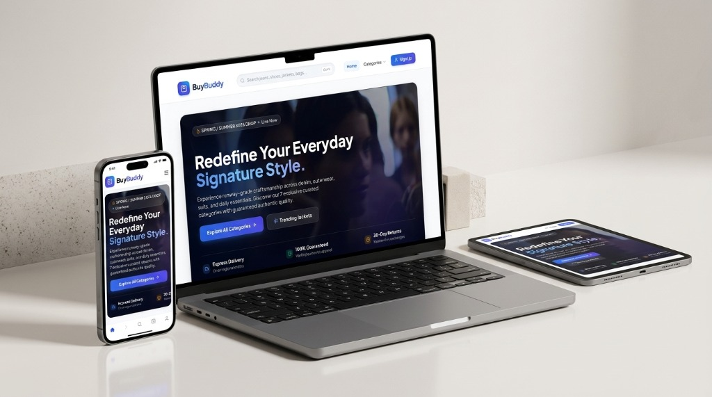

# 🛒 BuyBuddy — Full-Stack E-Commerce Platform

<p align="center">
  
</p>

<p align="center">
  <a href="https://e-commerce-store-anqa.onrender.com/"></a>
  <a href="https://github.com/IsravelTECH/E-commerce-store"></a>
  
  
  
  
  
  
</p>

---

## 🌟 Overview

**BuyBuddy** is a modern, high-performance omnichannel e-commerce platform crafted with a seamless user experience across Web, Tablet, and Mobile. It features authentic category styling, real-time cart and coupon synchronization, an ambient video hero banner, and an enterprise-grade admin analytics dashboard.

- 🌐 **Live Web Application:** [https://e-commerce-store-anqa.onrender.com/](https://e-commerce-store-anqa.onrender.com/)
- 📱 **Mobile App Repository:** [IsravelTECH/BuyBuddy](https://github.com/IsravelTECH/BuyBuddy)

---

## ✨ Features

- 👖 **7 Curated Fashion Categories**:
  - **Jeans** (7 curated styles)
  - **T-Shirts** (7 curated styles)
  - **Shoes** (7 curated styles)
  - **Glasses** (7 curated styles)
  - **Jackets** (7 curated styles)
  - **Suits** (7 curated styles)
  - **Bags** (7 curated styles)
- 🎬 **Cinematic Ambient Video Banner**: Immersive looping motion hero banner with clean overlay typography.
- 💳 **Stripe Payment Gateway**: Secure checkout with webhook verification and payment session status tracking.
- 🏷️ **Coupon & Voucher Engine**: Real-time discount redemption (e.g., `SAVE20`) with instant subtotal recalculations.
- 🔐 **Dual-Token Authentication**: Secure JWT authentication utilizing HTTP-Only cookies for access and refresh tokens.
- 📊 **Executive Admin Dashboard**: Real-time sales charts, revenue analytics, inventory management, and coupon generator.
- ⚡ **Redis In-Memory Caching**: Fast session and featured product caching via Upstash Redis.
- 📱 **Omnichannel Responsive Design**: Pixel-perfect layout tailored for desktop ultra-wide, laptops, tablets, and smartphones.

---

## 📁 Project Structure

```text
E-commerce-store/
│
├── backend/                  # Express REST API
│   ├── controllers/          # Auth, Product, Cart, Coupon, Payment & Analytics
│   ├── models/               # Mongoose schemas (User, Product, Order, Coupon)
│   ├── routes/               # Express API endpoints
│   ├── lib/                  # Database (MongoDB), Redis (Upstash) & Stripe clients
│   ├── middleware/           # Protected route and admin authorization guards
│   └── server.js             # Express application entrypoint
│
├── frontend/                 # React + Vite Single-Page Application
│   ├── public/
│   │   ├── images/categories/# Curated category photo assets
│   │   ├── videos/           # Ambient hero video background
│   │   ├── showcase.jpg      # Multi-device showcase mockup
│   │   └── favicon.ico       # BuyBuddy custom branded icons
│   ├── src/
│   │   ├── components/       # HeroVideoBanner, Navbar, CategoryItem, etc.
│   │   ├── pages/            # HomePage, CategoryPage, CartPage, AdminPage, etc.
│   │   ├── stores/           # Zustand reactive state stores (Auth, Cart, Products)
│   │   ├── lib/              # Axios API instance with credentials support
│   │   ├── App.jsx           # Route declarations & auth bootstrapping
│   │   └── main.jsx          # React DOM root
│   ├── package.json          # Frontend dependencies & Vite scripts
│   └── tailwind.config.js    # Tailwind theme extensions
│
├── showcase.jpg              # Multi-device mockup preview image
├── package.json              # Root project metadata & backend scripts
└── README.md
```

---

## 🚀 Getting Started

### 📋 Prerequisites

Ensure you have the following installed:
- [Node.js](https://nodejs.org/) (v18.x or v20.x recommended)
- [npm](https://www.npmjs.com/) (v9.x or higher)
- [MongoDB](https://www.mongodb.com/) (Local instance or free MongoDB Atlas cluster)

---

### 1️⃣ Clone the Repository

```bash
git clone https://github.com/IsravelTECH/E-commerce-store.git
cd E-commerce-store
```

---

### 2️⃣ Install Dependencies

Install root backend dependencies:
```bash
npm install
```

Install frontend dependencies:
```bash
cd frontend
npm install
cd ..
```

---

### 3️⃣ Configure Environment Variables

Create a `.env` file in the root directory:

```env
PORT=5000
MONGO_URI=your_mongodb_connection_string
UPSTASH_REDIS_URL=your_upstash_redis_url

ACCESS_TOKEN_SECRET=your_jwt_access_secret_key
REFRESH_TOKEN_SECRET=your_jwt_refresh_secret_key

CLOUDINARY_CLOUD_NAME=your_cloudinary_cloud_name
CLOUDINARY_API_KEY=your_cloudinary_api_key
CLOUDINARY_API_SECRET=your_cloudinary_api_secret

STRIPE_SECRET_KEY=your_stripe_secret_key
CLIENT_URL=http://localhost:5173
NODE_ENV=development
```

---

### 4️⃣ Run the Application Locally

#### Start the Backend Server (Port 5000)
In the root directory:
```bash
npm run dev
```
> The API will be running at `http://localhost:5000`.

#### Start the Frontend Client (Port 5173)
Open a new terminal window:
```bash
cd frontend
npm run dev
```
> The React web app will open at `http://localhost:5173`.

---

## 🌐 Connecting to the Live Cloud Backend

If you only want to work on or test the **frontend** without configuring a local MongoDB/Redis database, the live backend is already deployed and active:

- **Live API Endpoint:** `https://e-commerce-store-anqa.onrender.com/api`

You can configure `frontend/src/lib/axios.js` to point to the live server or keep the local proxy.

---

## 🛠️ Build for Production

To create an optimized production build of the frontend:
```bash
cd frontend
npm run build
```
The compiled static assets will be output to `frontend/dist/`.

To build both backend and frontend in a single step (e.g. for Render or Heroku):
```bash
npm run build
npm start
```

---

## 📱 Mobile App Companion

BuyBuddy also includes a native Flutter mobile app with automatic APK builds via GitHub Actions:
- Check out the mobile repository: [IsravelTECH/BuyBuddy](https://github.com/IsravelTECH/BuyBuddy)

---

## 📄 License

This project is licensed under the [MIT License](LICENSE).
